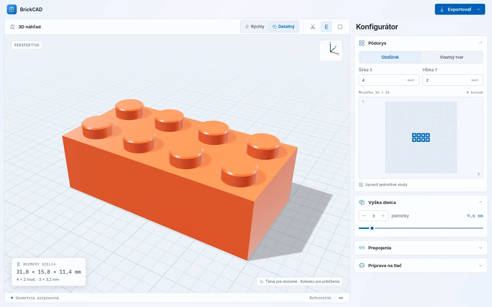
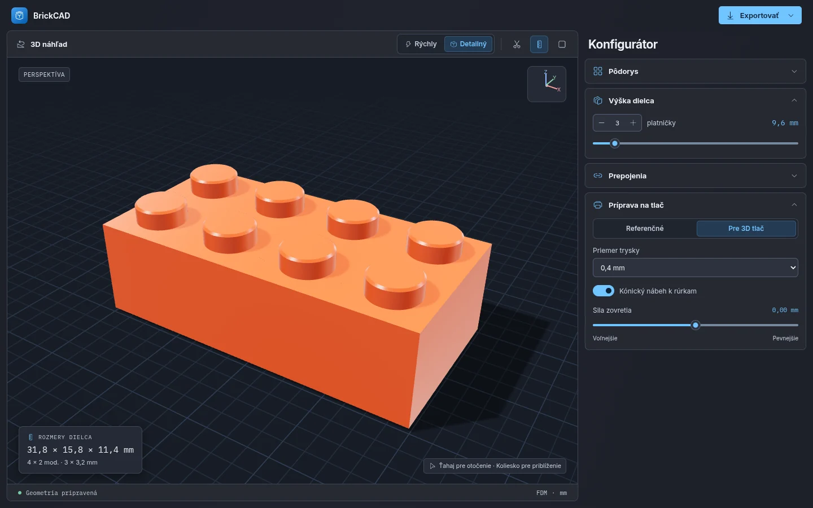
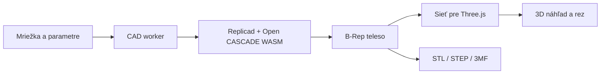

# BrickCAD

BrickCAD je webová aplikácia na návrh vlastných 3D tlačiteľných dielcov s rozstupom **8 mm**. V prehliadači môžeš nakresliť pôdorys, pridať spoje, skontrolovať vnútro v reze a stiahnuť **STL, STEP alebo 3MF**. CAD výpočet aj export prebiehajú lokálne.

[Rýchly štart](#start) · [Práca s editorom](#editor) · [Príklady dielcov](#examples) · [Tlač a export](#printing) · [Vývoj a testy](#development)



<details>
<summary><strong>Zobraziť tmavý režim a nastavenia FDM</strong></summary>



Rozhranie v štýle Windows 11 Fluent preberá motív systému. V užšom okne je konfigurátor pod 3D náhľadom.

</details>

<a name="start"></a>

## Rýchly štart

Potrebuješ Node.js **20.19+** v rade 20, prípadne **22.12+**, a moderný prehliadač s WebGL 2 pre 3D náhľad.

```sh
git clone https://github.com/bucala/Brick-maker.git
cd Brick-maker
npm ci
npm run dev
```

V prehliadači otvor adresu vypísanú v termináli. Predvolený diel má pôdorys **4 × 2 moduly**, výšku **3 platničky** a rozmery **31,8 × 15,8 × 11,4 mm** vrátane studov.

<a name="editor"></a>

## Práca s editorom

| Ovládanie | Použitie |
| --- | --- |
| **Obdĺžnik** | Zadaj šírku X a hĺbku Y od 1 do 16 modulov. |
| **Vlastný tvar** | Klikaním alebo ťahaním kresli v mriežke 16 × 16. Môžeš použiť *Vyplniť*, *Vymazať* a zrkadlenie podľa X alebo Y. |
| **Upraviť jednotlivé study** | Klikaním na obsadené bunky zapínaj alebo vypínaj horné study. V mriežke sa dá pohybovať aj šípkami a bunka sa mení medzerníkom. |
| **Výška dielca** | Nastav 1 až 24 platničiek po 3,2 mm. Tlačidlá − a + menia výšku o jednu platničku. |
| **Rýchly / Detailný** | Rýchly náhľad sa počíta bez drobných skosení a rebier. Detailný náhľad zobrazí geometriu použitú pri exporte. |
| **3D náhľad** | Ťahaj ľavým tlačidlom pre otočenie, pravým pre posun a kolieskom priblíž. Kompas ponúka pevné pohľady *Zhora*, *Zdola*, *Spredu* a *Zboku*. |
| **Rez dielcom** | Vyber os X, Y alebo Z a posuvníkom premiestni rovinu rezu. Rez slúži na kontrolu modelu v náhľade. |

<details>
<summary><strong>Možnosti spojov a šikmín</strong></summary>

- **Horný povrch** môže mať plné study, duté study alebo hladký povrch.
- **Spodné spoje** vznikajú automaticky. Rúrka patrí do priesečníka obsadeného bloku 2 × 2. Medzi susednými bunkami v úseku širokom jeden modul môže vzniknúť kolík.
- **Technic** podporuje okrúhly otvor s osadením pre pin a krížový otvor pre osku. Smer môže zvoliť aplikácia alebo ho nastavíš podľa osi X či Y. Otvory vznikajú medzi protiľahlými úsekmi stien širokými najmenej dva moduly.
- **SNOT** pridá bočné study alebo priehlbiny na vybranej strane.
- **Šikmina** môže mať 33°, 45° alebo opačnú orientáciu pri 45°. Study, ktoré by zasahovali cez zlom medzi plochami, sa vynechajú.

Technic a SNOT vyžadujú rovnú hornú plochu a výšku aspoň troch platničiek.

</details>

<a name="examples"></a>

## Príklady dielcov

<details open>
<summary><strong>Referenčná kocka 4 × 2</strong></summary>

1. Vyber **Obdĺžnik**, nastav X na 4 a Y na 2.
2. Nechaj 3 platničky, **Plné study** a **Referenčné**.
3. V pohľade **Zdola** skontroluj tri rúrky. V perspektíve porovnaj rozmery **31,8 × 15,8 × 11,4 mm**.

</details>

<details>
<summary><strong>Dutý rám 3 × 3</strong></summary>

1. Vyber **Vlastný tvar** a vymaž mriežku.
2. Vyplň osem buniek po obvode štvorca 3 × 3. Bod označuje prázdnu bunku.

   ```text
   ■ ■ ■
   ■ · ■
   ■ ■ ■
   ```

3. Nechaj tri platničky a plné study. Výsledný rám má **23,8 × 23,8 × 11,4 mm**. Pohľad zhora zobrazí otvor v strede.

</details>

<details>
<summary><strong>Diel 4 × 2 s otvormi Technic</strong></summary>

1. Zadaj obdĺžnik 4 × 2, výšku tri platničky a rovnú hornú plochu.
2. V **Prepojeniach** vyber *Okrúhly otvor pre pin* a os **Y**.
3. V pohľade spredu skontroluj tri otvory s osadením. Rezom v osi Y si zobraz priebežné kanály.

</details>

<a name="printing"></a>

## Tlač a export

1. V **Príprave na tlač** vyber nominálne rozmery alebo režim **Pre 3D tlač**.
2. Pre FDM nastav trysku **0,2**, **0,4** alebo **0,6 mm**. Profily zväčšujú vybrané otvory o 0,15, 0,20 alebo 0,25 mm. Detailný model má spodné skosenie **0,3 mm** a voliteľný kónický nábeh pri rúrkach.
3. Posuvník **Sila zovretia** mení priemery spojov v rozsahu **−0,15 až +0,15 mm**. Kladná hodnota sprísni spoj a záporná ho uvoľní.
4. Po dokončení výpočtu klikni na **Exportovať** a vyber formát podľa ďalšieho použitia.

| Formát | Výstup | Použitie |
| --- | --- | --- |
| **STL** | Binárna sieť. Rozmery sú zapísané v mm. | Import do slicera. Pri importe nastav milimetre, pretože STL jednotku neukladá. |
| **STEP** | B-Rep teleso s analytickými plochami. | Úprava, meranie alebo zostava v CAD. |
| **3MF** | Zabalená sieť s jednotkou *millimeter*. | Import do slicera, ktorý podporuje 3MF. |

<details>
<summary><strong>Nominálne rozmery a kontrola pred tlačou</strong></summary>

| Prvok | Nominálna hodnota |
| --- | ---: |
| Modulárny rozstup | 8,0 mm |
| Výška platničky | 3,2 mm |
| Obvodová stena a strop | 1,2 mm |
| Vôľa na každej strane vonkajšieho pôdorysu | 0,1 mm |
| Horný stud | Ø 4,8 mm × 1,8 mm |
| Vnútorný otvor dutého studu | Ø 3,2 mm |
| Spodná rúrka | Ø ~6,51 mm zvonka, Ø 4,8 mm zvnútra |
| Spodný kolík | Ø 3,2 mm |
| Okrúhly otvor Technic | Ø 4,8 mm v osi 5,8 mm od spodku |
| Osadenie otvoru Technic | Ø 6,1 mm, hĺbka 0,8 mm na každej strane |

Pred tlačou celej série skontroluj v sliceri mierku, orientáciu a podpery. Na krátkej skúšobnej tlači over vôľu spojov s dielmi, ktoré chceš použiť. Výsledok ovplyvňuje tlačiareň, materiál aj kalibrácia. Oddelené časti pôdorysu zostanú v exporte geometricky oddelené.

</details>

<a name="development"></a>

## Vývoj a testy

```sh
npm test
npm run build
npm run preview
```

`npm test` overuje výpočet pôdorysu, rozmery a platnosť CAD geometrie, binárne STL, spätný import STEP a uzavretosť siete 3MF. Produkčný build je v `dist/`.

<details>
<summary><strong>Test produkčnej verzie v Chromiu</strong></summary>

```sh
npx playwright install chromium
npm run test:browser
```

Ak máš vhodný Chromium už nainštalovaný, nastav cestu cez `CHROMIUM_PATH`. Test otvorí produkčný build, zmení pôdorys a nastavenia, prepne motív a overí sťahovanie troch formátov.

</details>

<details>
<summary><strong>Architektúra a zdrojové súbory</strong></summary>



| Zdroj | Zodpovednosť |
| --- | --- |
| [`src/main.js`](src/main.js) | Konfigurátor, mriežka a plánovanie prepočtov |
| [`src/footprint.js`](src/footprint.js) | Obrysy buniek a umiestnenie spojov |
| [`src/model.js`](src/model.js) | Generovanie B-Rep telesa |
| [`src/cad.worker.js`](src/cad.worker.js) | CAD jadro, validácia tvaru a export |
| [`src/viewport.js`](src/viewport.js) | Kamera, vykresľovanie a rez |
| [`src/export.js`](src/export.js) | Balenie siete 3MF |

</details>

## Licencia

Zdrojový kód je dostupný podľa [GNU GPL v3.0](LICENSE).
